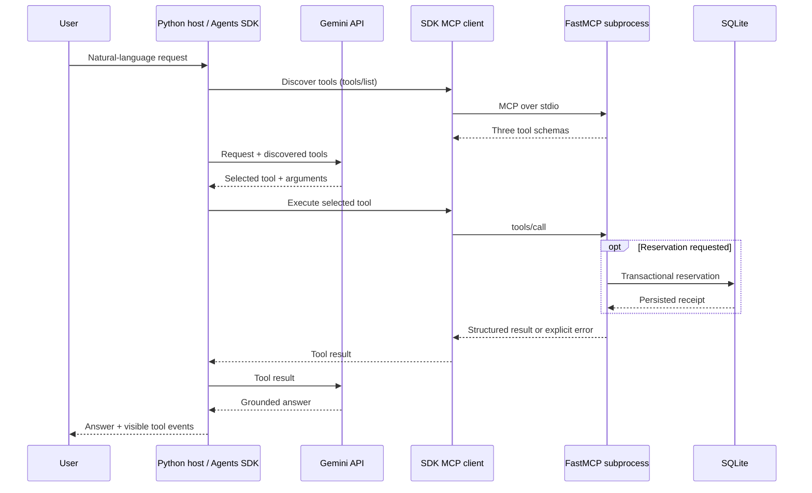

# Campus Library MCP

A small, working library assistant for **EECE 503P/798S - C5: Agent Tools**.
It uses **FastMCP**, the **OpenAI Agents SDK**, and **Gemini's API**. Exactly three
MCP tools separate data retrieval, a persistent action, and a coordinated workflow.

The eight books, authors, copy counts, and student IDs are **fictional teaching data**.
This does not connect to an actual campus library. Reservations change a real local
SQLite database and survive process restarts.

## Architecture



The host owns the agent loop and the MCP connection. Gemini chooses tool calls;
it does not connect directly to the server. `MCPServerStdio` manages the protocol
client/session and launches `python -m campus_library.server` as a child process.
FastMCP exposes capabilities independently of the model provider. No OpenAI API key
is required; OpenAI trace export is disabled. Server logs go to **stderr**;
**stdout** remains reserved for MCP protocol traffic.

## The three tools

| Category | Tool | Inputs | Structured output | Predictable failures |
|---|---|---|---|---|
| Data | `search_catalog` | `query: str`, `limit: int = 5` | `SearchResult`: query, total matches, books with availability | `INVALID_QUERY`, `INVALID_LIMIT`, `STORAGE_UNAVAILABLE` |
| Action | `reserve_book` | `book_id: str`, `student_id: str` | `ReservationResult`: persisted receipt, duplicate flag | `BOOK_NOT_FOUND`, `INVALID_STUDENT_ID`, `NO_COPIES`, `STORAGE_UNAVAILABLE` |
| Orchestration | `reserve_matching_book` | `query: str`, `student_id: str` | `WorkflowResult`: query, selection policy, steps, reservation result | `INVALID_QUERY`, `INVALID_STUDENT_ID`, `NO_MATCH`, `NO_AVAILABLE_MATCH`, `STORAGE_UNAVAILABLE` |

Every tool has a description, annotated argument descriptions, a generated JSON
input schema, a Pydantic output schema, and MCP behavior annotations. Expected
domain failures become MCP tool errors; they are not disguised as successful text.

The orchestration tool invokes the **same service methods** used by the Data and
Action tool wrappers, in that order. It does not duplicate their logic or start a
second MCP connection inside the server. Its single purpose is fulfilling a
topic-based reservation. Nested server logs show the actual search/action sequence.

One additional **resource**, `catalog://books`, exposes static book metadata through
`@mcp.resource`. It is not a fourth tool. The agent uses `search_catalog` for current
availability.

## Setup

Use **Python 3.12** for the tested environment. Python 3.11+ is declared compatible.
An internet connection is needed to install dependencies and call Gemini.

```powershell
git clone https://github.com/HusseinMoukalled/campus-library-mcp.git
cd campus-library-mcp
python -m venv .venv
.\.venv\Scripts\python.exe -m pip install -r requirements.lock
.\.venv\Scripts\python.exe -m pip install --no-deps -e .
Copy-Item .env.example .env
```

On macOS/Linux, use `.venv/bin/python` instead of `.\.venv\Scripts\python.exe`
and `cp .env.example .env` instead of `Copy-Item`.

Get a Gemini API key from [Google AI Studio](https://aistudio.google.com/apikey).
Edit `.env` locally:

```dotenv
GEMINI_API_KEY=your_local_key
GEMINI_MODEL=gemini-3.1-flash-lite
LIBRARY_DB_PATH=runtime/library.sqlite3
```

The model must be available in your project's free tier and support function
calling. Free-tier quotas and model availability depend on Google's current
offering and your account. `GEMINI_MODEL` can be changed without modifying code.
The lock file pins the dependency versions used for verification; `pyproject.toml`
describes the project and minimum requirements. `.env` and runtime data are ignored
by Git. Never commit your key.

## Run

```powershell
.\.venv\Scripts\python.exe -m campus_library.agent
```

The terminal displays discovered tools, actual SDK tool calls and results, and the
assistant's response. Server messages show nested operations. Conversation context
is retained until exit. Enter `/exit` or press Ctrl+C to stop.

Example requests:

- `Find books about python. Only look up information.`
- `Reserve book B001 for student S1001.`
- `Reserve an available book about agents for student S1002.`
- `Try to reserve book B006 for student S1003.`
- `Try to reserve a book about quantum dragons for student S1004.`

Single-request mode:

```powershell
.\.venv\Scripts\python.exe -m campus_library.agent --prompt "Find books about python."
```

The host also has an installed entry point, `library-agent`. Run the MCP server on
its own with `python -m campus_library.server` only when attaching another MCP
client; it waits for JSON-RPC messages rather than accepting natural-language chat.

## Verification

All automated checks use temporary databases; they leave normal chat reservations
untouched. No credentials are needed for the first three commands:

```powershell
.\.venv\Scripts\python.exe -m ruff check .
.\.venv\Scripts\python.exe -m pytest -q
.\.venv\Scripts\python.exe -m campus_library.check
```

The MCP check uses the actual **Agents SDK MCP client**, launches the FastMCP
subprocess, discovers all three schemas, calls each tool, tests a failure for each,
and restarts the server to verify persistence/idempotency. Unit tests additionally
check read-only behavior, concurrency, selection, and storage failures. The GitHub
Actions workflow runs credential-free tests on Windows and Linux.

For an actual Gemini-backed agent check:

```powershell
.\.venv\Scripts\python.exe scripts/live_smoke.py
```

This issues six independent requests covering all three tools and their failures,
asserts the model's selected tool names, inspects actual tool errors, and checks
the resulting database. It makes multiple Gemini API calls and requires remaining
quota. It does not force tool selection or replace the model with canned responses.

## Behavior and limitations

- Search is case-insensitive substring matching: **every whitespace-separated query
  word** must occur in the ID, title, author or topics. Results sort by book ID.
  `total_matches` is measured before applying the 1-20 result limit. No matches is
  a successful empty search.
- Reservations use IDs such as `S1001`, contain UTC timestamps, and never expire.
  Repeating the same student/book pair returns the original receipt without taking
  another copy. SQLite transactions serialize availability checks and inserts.
- The workflow tries matches in book-ID order. It reuses an existing reservation
  when encountered, skips books with no remaining copies, and handles a copy
  disappearing between search and save. Exhaustion produces `NO_AVAILABLE_MATCH`.
- The database is created lazily on an action; searches do not create or update
  storage. A failed availability check never silently assumes a book is free.
- This is a local, single-user teaching application. Student IDs are validated
  labels, not authenticated identities. There is no cancellation, lending period,
  account system, or remote deployment. These would require additional scope.
- To start with clean data, stop the host and set `LIBRARY_DB_PATH` to a **new**
  filename in `.env`. Existing reservations remain in the old file.

If Gemini reports a quota/rate-limit error, wait and retry after checking your AI
Studio quota. For access/model errors, check the key and `GEMINI_MODEL`. Local tools
can still be checked without Gemini using `python -m campus_library.check`.

## Submission files

- [Written summary](docs/summary.md): 300-400 words, with linked sources.
- [Reflection](docs/reflection.md): two paragraphs.
- `src/campus_library/server.py`: FastMCP tools/resource.
- `src/campus_library/agent.py`: Agents SDK host and Gemini configuration.
- `src/campus_library/service.py` and `models.py`: reusable logic and contracts.
- `tests/`, `scripts/live_smoke.py`, `requirements.lock`, and this setup README.

## References

- [Assigned Hugging Face article](https://huggingface.co/blog/Kseniase/mcp)
- [Full article linked by its author](https://www.turingpost.com/p/mcp)
- [MCP architecture](https://modelcontextprotocol.io/docs/learn/architecture)
- [FastMCP tool documentation](https://gofastmcp.com/servers/tools)
- [OpenAI Agents SDK integration guidance](https://developers.openai.com/api/docs/guides/agents/integrations-observability)
- [Gemini OpenAI compatibility](https://ai.google.dev/gemini-api/docs/openai)
